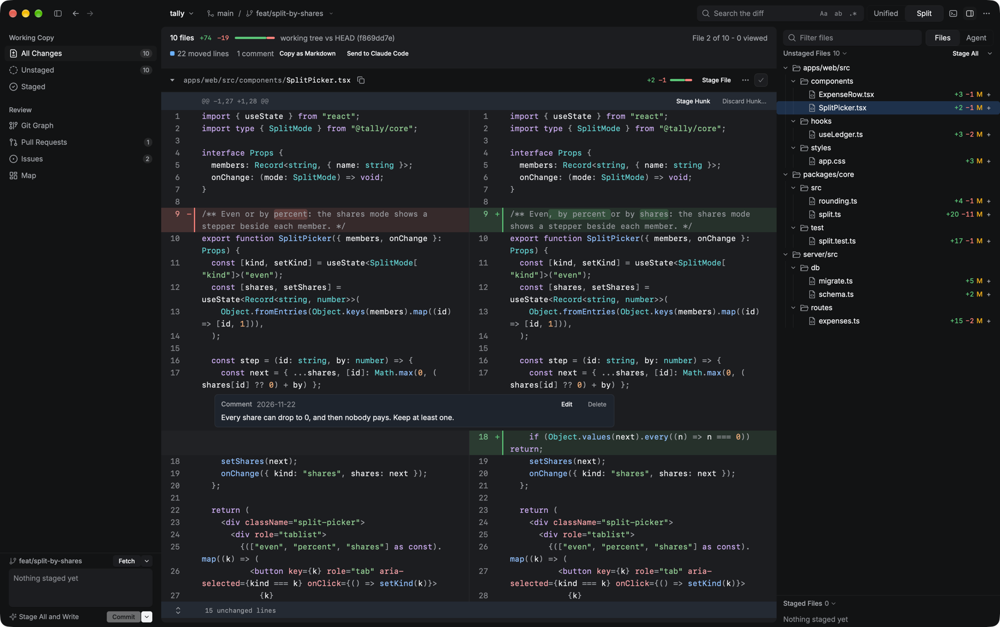
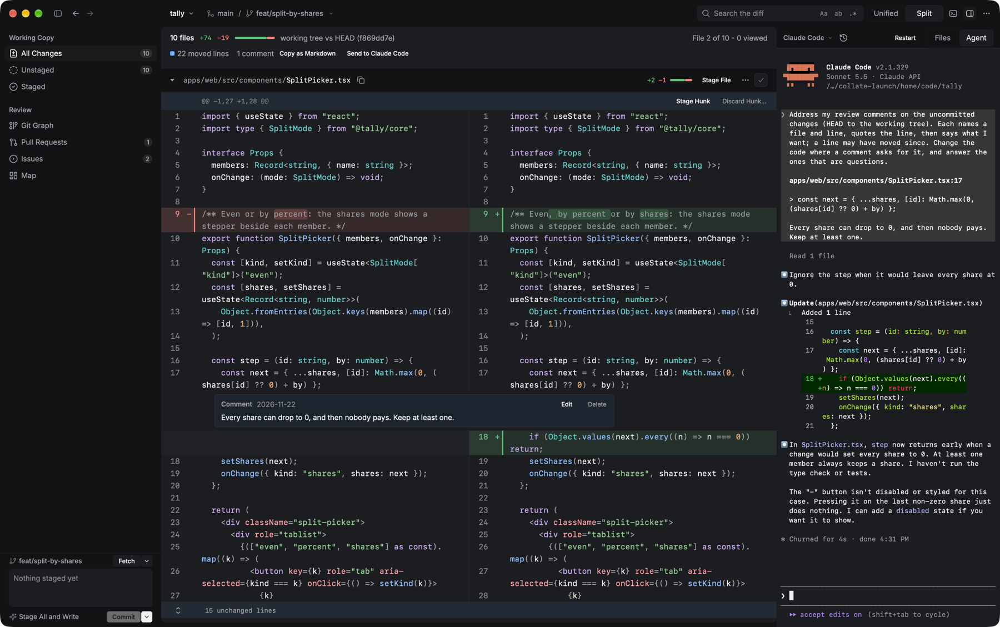
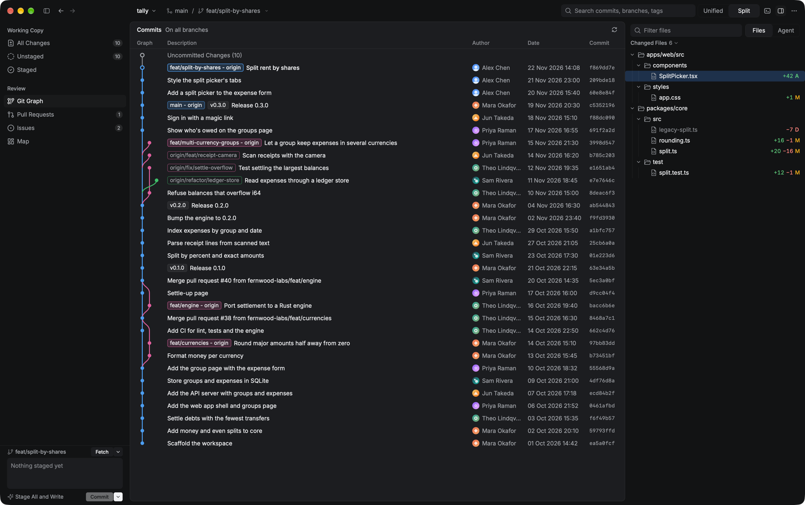
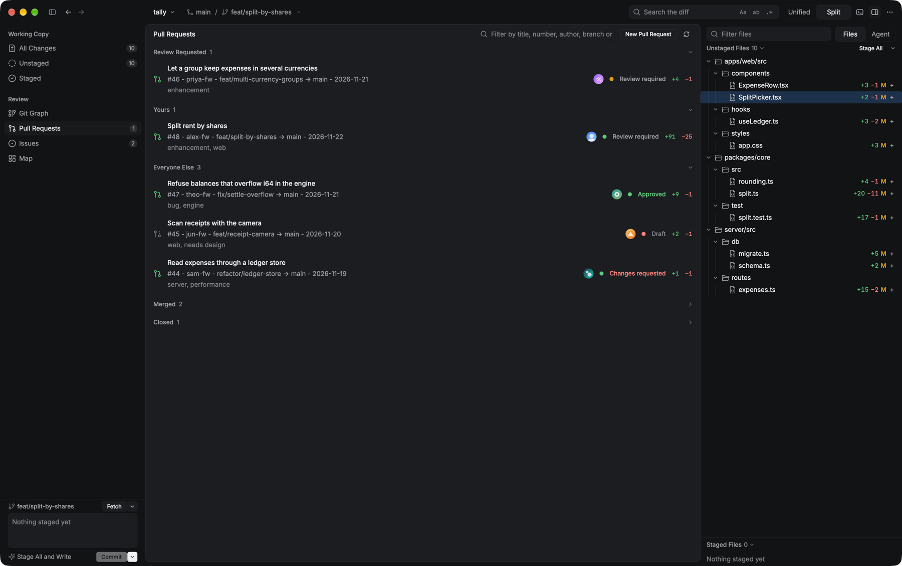
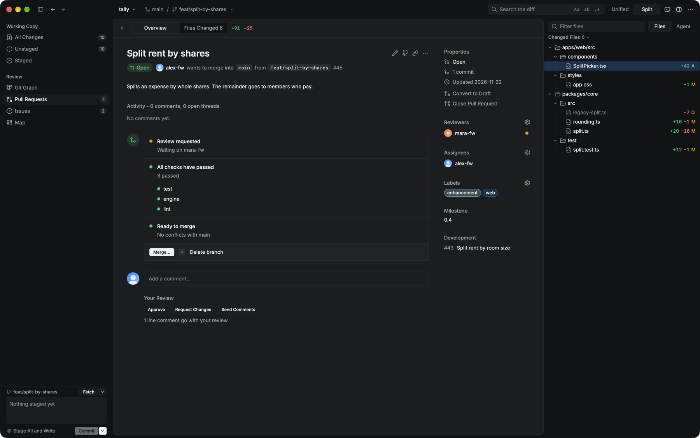
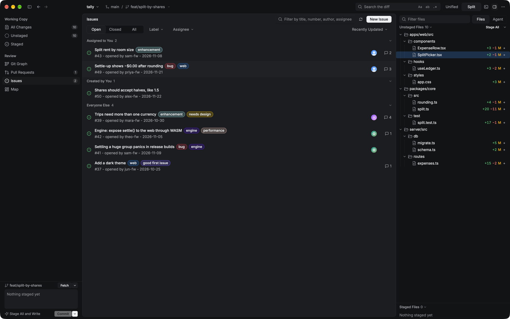
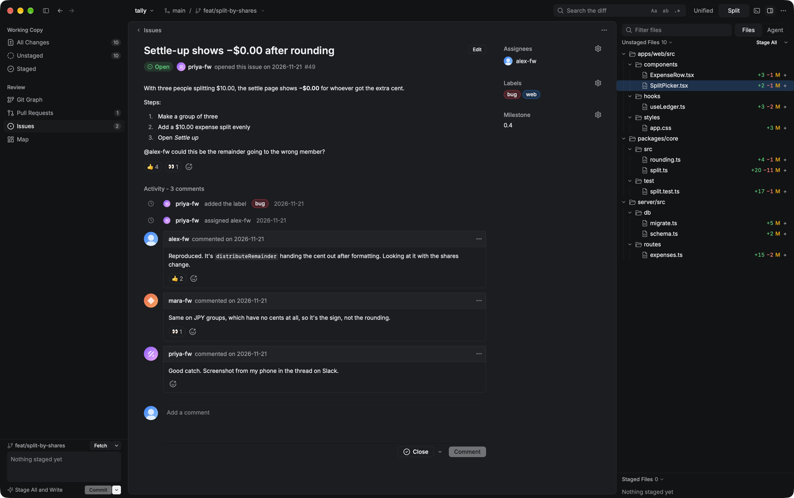
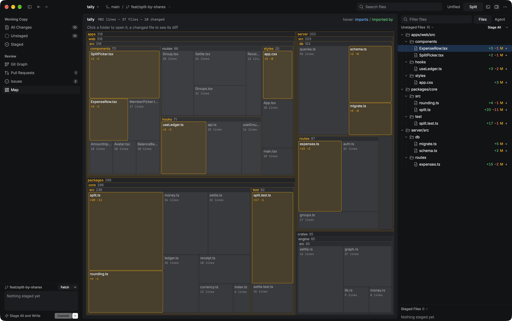

# Collate

A fast, lightweight git diff viewer for macOS, built on [Rune](https://github.com/anomalyco/rune).

Collate shows what changed in a git repository beside a file tree and refreshes as you edit.
Review, stage, discard and commit without leaving the diff; review GitHub pull requests too.



## Install

```sh
npx collate-app@latest
```

That checks your Mac, installs anything missing, puts Collate in Applications and adds a
`collate` command. Run it again to update; add `--uninstall` to remove it.

You need macOS 13 or newer and [Node.js](https://nodejs.org) 18 or newer. Then open Collate
from Launchpad, or run `collate` in a repository.

Or with [Homebrew](https://brew.sh): `brew install --cask dishant1804/tap/collate`. Collate
updates itself, so `brew upgrade` leaves it alone unless you add `--greedy`.

Or download `Collate-<version>-macos-universal.dmg` from the
[latest release](https://github.com/Dishant1804/Collate/releases/latest), open it and drag
Collate to Applications. Releases are signed with a Developer ID and notarized by Apple, so
they open without a warning. Collate can check for newer releases and install them (Settings).

Optional: the GitHub CLI (`brew install gh`, then `gh auth login`) for pull requests and
commit authors' pictures.

## A look around

Leave notes on lines and send them to your agent from the diff; it works in the Agent tab
beside it, and its edit shows up in the diff as it lands.



The Git Graph shows every branch and its commits, with their authors and tags.



Pull requests: the list by what needs you, and each one's overview with its reviews, checks
and merge button.

| | |
| --- | --- |
|  |  |

Issues: the list, and each issue with its comments.

| | |
| --- | --- |
|  |  |

The Map lays out the repository's source files by size and shows which ones changed.



## The `collate` command

| Command | Opens |
| --- | --- |
| `collate [folder]` | the repository's changes |
| `collate main..topic`, `collate HEAD~2` | a range or a commit |
| `collate --staged`, `--unstaged`, `--branch`, `--history` | that view |
| `collate --split`, `--unified`, `-- src/api` | that layout; the file list filtered |
| `collate a.rs b.rs`, `collate old/ new/` | two files or two folders compared |
| `collate fix.patch`, `git diff \| collate` | a patch |
| `collate --merge base local remote merged` | the merge editor, for `git mergetool` |

Settings > Review > Git's diff and merge tool, or Help > Use Collate for git difftool and
mergetool, makes `git difftool` and `git mergetool` open Collate. Dropping a folder on the
window opens it; a patch, or two files or folders, is shown on its own.

## Agents

A coding agent can drive the window you're looking at: read the view, the files and the
selected lines, go to a file, line or commit, select lines, leave comments, and run any menu
command by its id. `collate --mcp` is the MCP server for it; `scripts/install-agent.sh`
registers it with Claude Code and installs the `collate` skill (`skills/collate`), which
tells the agent how to use it. Agents ask before committing, pushing or discarding, and a
discard still waits for you in its dialog.

## Keys

Every command is also in the menu bar (File, View, Go, Changes, Branch, Agent), with its key
beside it; `⇧⌘P` finds and runs one by name. Right-click a line, a file (in the diff or the
lists), a commit in the Git Graph or a project for what acts on it.

| Key | Action |
|---|---|
| `j` `k` | Next / previous change |
| `]` `[` | Next / previous file |
| `a` `u` `x` | Stage, unstage, discard the selected lines, or the change at the top |
| `A` `U` `X` | The same for the whole file |
| `v` | Mark the file viewed |
| `c` | Comment on the selected line |
| `i` | Ask the agent about the selected lines, or to change them |
| `y` `Y` | Copy the selected lines' reference (`path#L10-L25`), or the lines as a diff for an agent |
| `o` | Open the file in your editor |
| `⌘F` or `⌘K`, `n` `N` | Search this view (the diff, the Map's files, History's commits and branches), next / previous match |
| `⌥⌘C` `⌥⌘W` `⌥⌘R` | Search: match case, whole words, regular expression |
| `⌘P` `⌘L` | Go to a file (`file:line` for a line), go to a line |
| `⇧⌘P` | Find and run any command by name |
| `⌘[` `⌘]` | Back / forward through the places you've been |
| `m` | Jump to the other end of a move |
| `b` | Inline blame: who last changed each line, beside the numbers |
| `p` | Pick single word changes to stage |
| `z` `Z` | Fold / unfold every file |
| `s` | Unified / split |
| `w` `W` | Wrap long lines / hide whitespace changes |
| `1` to `5` | All changes, staged, unstaged, pull request preview, history |
| `<` `>`, `↩`, `Esc` | History: older / newer commit, open its diff, back to the graph |
| `⇧⌘B` `⌥⌘0` `⌘J` | Show / hide the views sidebar, the staging panel, the terminal |
| `⌘↩` | Commit what's staged |
| `⌘Z` | Undo the last commit, merge, rebase, pull, reset, cherry-pick, revert or switch |
| `n` `p`, `1` `2` `3` | Merge editor: next / previous conflict, take ours, theirs or both |
| `⌘O` | Add a project |
| `r` | Read everything again |
| `?` | Every key, by section; type to search them |
| `⌘,` | Settings |

## What Collate stores and sends

Collate keeps its files under your home folder and nowhere else:

- `~/Library/Application Support/Collate/`: settings, the list of projects, viewed marks,
  comments.
- `~/Library/Caches/Collate/avatars/`: commit authors' pictures.

Fetch, pull and push talk to your remotes when you ask, through `git` and your own
credentials. Apart from those, the only network use is the pictures and the grammars for
extra languages. For a project hosted on github.com, Collate asks GitHub which account a commit belongs to (through `gh` when it is installed, else the
public API) and downloads that account's avatar. That request names the repository and a
commit hash. Nothing else leaves your machine, and there is no telemetry.

## Contributing

See [CONTRIBUTING.md](CONTRIBUTING.md).

## License

MIT. See [LICENSE](LICENSE).
